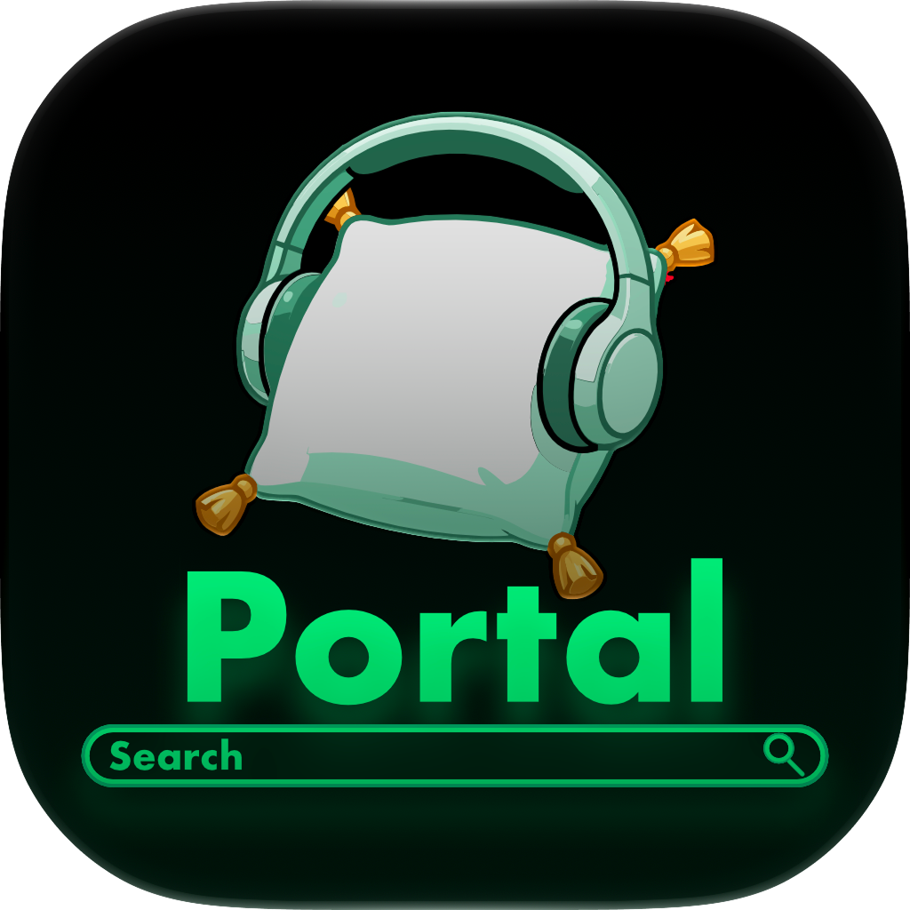

<!-- Title -->
<h1 align="center">ComfyPortal</h1>

<!-- App Icon -->

  

## Overview
ComfyPortal is a native macOS web browser built with SwiftUI, AppKit, and a modified version of WebKit.

Originally developed as a personal project, ComfyPortal aims to provide a customizable browsing experience while remaining lightweight and native to macOS.

## Downloads

ComfyPortal is available directly for macOS.
- [Download the latest release](https://github.com/AryanRogye/ComfyPortalPublic/releases/latest)
- [View previous releases](https://github.com/AryanRogye/ComfyPortalPublic/releases)

## Features

- Native macOS interface with customizable appearance
- Split tabs, pinned tabs, and visual tab switching
- Tab hibernation and automatic tab expiration
- Built-in content blocking with uBlock Origin Lite
- Private browsing and Keychain-backed password management
- Integrated Markdown notes editor
- Built-in MCP server for browser automation
- Task manager and JavaScript runner
- Automatic updates through Sparkle
- Picture-in-Picture support
- Ranked address bar suggestions
- Integrated AI sidebar with ChatGPT, Claude, and Gemini

ComfyPortal supports automatic updates.

## WebKit

ComfyPortal uses a modified version of WebKit maintained separately from the browser itself.

The modified WebKit source is available at [ComfyWebKit](https://github.com/AryanRogye/ComfyWebKit).

## Related Projects

- [ComfyWebKit](https://github.com/AryanRogye/ComfyWebKit) — Modified WebKit engine.
- [ComfyMarkdownStore](https://github.com/AryanRogye/ComfyMarkdownStore) — Markdown storage and UI components.
- [LocalShortcuts](https://github.com/AryanRogye/LocalShortcuts) — Native keyboard shortcut management.

## Requirements

- macOS 15.4 or later

## Project Status

ComfyPortal is actively developed and maintained as an independent project. The browser's application source is currently private, while its modified WebKit source is publicly available.

Bug reports, feature requests, and feedback are welcome.
